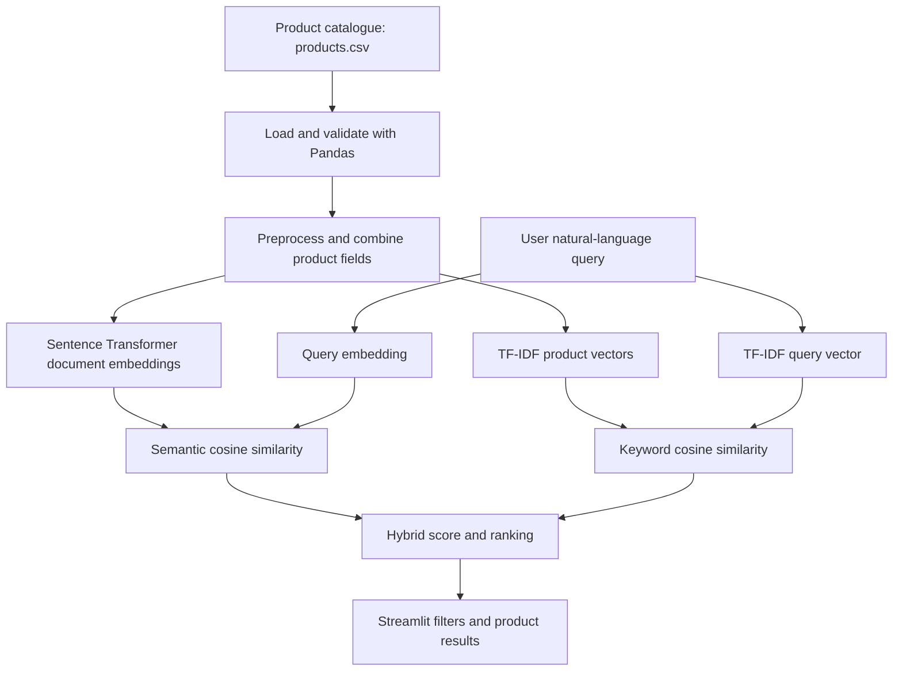

# FINDLY AI — Semantic Search Engine for E-Commerce

FINDLY AI is a Python-based e-commerce product discovery prototype. It lets a user describe what they need in natural language and ranks products using a combination of semantic similarity and keyword similarity.

Instead of relying only on exact word matches, the system uses a pre-trained Sentence Transformer to represent product text and user queries as vectors. It combines the resulting semantic score with a TF-IDF keyword score to produce a hybrid ranking.

> **Project scope:** FINDLY AI searches a local product catalogue stored in `data/products.csv`. It is a prototype, not a live Amazon/Flipkart search service, and it does not check retailer inventory or live prices.

---

## Contents

- [Features](#features)
- [How it works](#how-it-works)
- [Technology stack](#technology-stack)
- [Project structure](#project-structure)
- [Dataset format](#dataset-format)
- [Installation](#installation)
- [Run the application](#run-the-application)
- [Run the evaluation](#run-the-evaluation)
- [Hybrid ranking method](#hybrid-ranking-method)
- [Evaluation metrics](#evaluation-metrics)
- [Product image handling](#product-image-handling)
- [Current limitations](#current-limitations)
- [Possible future improvements](#possible-future-improvements)

---

## Features

### Natural-language product search

Users can enter descriptive queries such as:

- `I need waterproof shoes for hiking`
- `Something warm to wear in winter`
- `A laptop for programming`
- `Equipment for cold-weather camping`

The system compares the meaning of the query with product text, then ranks the catalogue.

### Hybrid retrieval

FINDLY AI combines:

- **Semantic similarity:** embeddings generated by `all-MiniLM-L6-v2` and compared with cosine similarity.
- **Keyword similarity:** TF-IDF vectors compared with cosine similarity.

### Shopping interface

The Streamlit interface includes:

- Product discovery page and natural-language search
- Quick-search examples
- Category and brand filters
- Price range filter
- Minimum relevance threshold
- Sorting by best match or price
- Configurable products per page and pagination
- Product cards with category, brand, description, price and relevance score
- Relevance-score breakdown
- Session-based wishlist
- Recent search history during the current session
- CSV export of filtered search results
- About tab describing the project and search pipeline

### Product photographs

Product cards support three image sources, in priority order:

1. A local image named with the product ID in `assets/products/`.
2. An `image_url` column in the product data, when present.
3. An automatic Openverse image search for a relevant openly licensed photograph.

Openverse results are subject to availability and matching checks. The app shows creator, source and licence attribution when that information is provided. If no suitable match is returned, the app displays a category illustration instead of deliberately showing an unrelated photograph.

---

## How it works

### Search pipeline



### Step-by-step process

1. **Load product data:** `data_loader.py` reads the CSV catalogue and checks its required fields.
2. **Prepare searchable text:** `preprocess.py` cleans text and combines the product name, category, brand and description into a `search_text` field.
3. **Create product representations:** `semantic_search.py` loads the pre-trained sentence embedding model and creates an embedding for each product. It also builds a TF-IDF index over the same product text.
4. **Process a query:** the user's query is converted to a sentence embedding and a TF-IDF query vector.
5. **Calculate similarity:** cosine similarity is calculated separately for the semantic and keyword representations.
6. **Combine scores:** the two scores are combined using the configured hybrid weights.
7. **Rank and display:** products are sorted by the hybrid score. The Streamlit interface applies optional filters and displays the results.

Product embeddings and the TF-IDF product index are built when the search engine is initialized. They are reused for subsequent searches during the app session.

---

## Technology stack

| Technology | Role in FINDLY AI |
|---|---|
| Python | Main programming language |
| Streamlit | Interactive web interface |
| Pandas | Load, validate and manipulate the product catalogue |
| NumPy | Numerical calculations in evaluation |
| Sentence Transformers | Generate semantic text embeddings |
| `all-MiniLM-L6-v2` | Pre-trained sentence embedding model |
| Scikit-learn | TF-IDF vectorization and cosine similarity |
| Requests | Call the Openverse image-search API |
| Openverse | Optional source of openly licensed product-related photographs |

### Main NLP model

**Model:** `sentence-transformers/all-MiniLM-L6-v2`

The model creates **384-dimensional embeddings**. FINDLY AI uses the Sentence Transformers `encode_document()` method for product text and `encode_query()` for the user's query.

The model is pre-trained. This project uses it for embedding generation and retrieval; it does **not** train or fine-tune the Transformer from scratch.

Model information: <https://huggingface.co/sentence-transformers/all-MiniLM-L6-v2>

Sentence Transformers documentation: <https://www.sbert.net/>

---

## Project structure

```text
Semantic-Ecommerce-Search/
│
├── assets/
│   └── products/              # Optional local product images, named by product ID
│
├── data/
│   └── products.csv           # Product catalogue
│
├── src/
│   ├── __init__.py            # Marks src as a Python package
│   ├── data_loader.py         # Loads and validates the CSV catalogue
│   ├── preprocess.py          # Cleans and combines product text
│   ├── semantic_search.py     # Embeddings, TF-IDF, hybrid ranking and search
│   └── evaluate.py            # Search evaluation and TF-IDF baseline
│
├── app.py                     # Streamlit application and user interface
├── requirements.txt           # Python dependencies
├── README.md                  # Project documentation
└── .gitignore                 # Files excluded from version control
```

### Responsibilities of the main files

- **`data/products.csv`** — stores product IDs, names, categories, brands, prices and descriptions.
- **`src/data_loader.py`** — loads the CSV and validates required columns and values.
- **`src/preprocess.py`** — normalizes text and creates the combined searchable product text.
- **`src/semantic_search.py`** — loads the Transformer, builds product embeddings and the TF-IDF index, calculates similarity scores and returns ranked results.
- **`src/evaluate.py`** — runs the configured evaluation queries and reports retrieval metrics for the search method and keyword baseline.
- **`app.py`** — provides the FINDLY AI Streamlit interface, filters, results, wishlist, search history, pagination, CSV export and optional image lookup.

---

## Dataset format

The product catalogue is stored in `data/products.csv`. The expected core columns are:

| Column | Description | Example |
|---|---|---|
| `product_id` | Unique product identifier | `26` |
| `product_name` | Product display name | `Waterproof Hiking Boots` |
| `category` | Product department | `Footwear` |
| `brand` | Product brand | `Quechua` |
| `price` | Product price as a number | `3499` |
| `description` | Natural-language product description | `Waterproof trekking boots with anti-slip soles...` |

The project catalogue was expanded to **80 sample products** during development. The app calculates the current catalogue size from the CSV, so the displayed count will change if products are added or removed.

### Adding a product

Add a new CSV row with a unique product ID and values for all required columns. Keep the CSV header unchanged. For example:

```csv
81,Insulated Travel Mug,Accessories,ExampleBrand,799,Reusable insulated mug that keeps hot drinks warm while travelling
```

After changing the catalogue, restart the app so the search engine rebuilds its product embeddings and TF-IDF index.

---

## Installation

### Prerequisites

- Windows, macOS or Linux
- Python 3.10 or later recommended; this project was developed with Python 3.11
- Internet connection for the first model download and optional Openverse photo searches
- Visual Studio Code or another Python editor (optional)

### 1. Clone or open the project

Open the project directory in VS Code. The commands below assume the terminal is in the project root, where `app.py` is located.

### 2. Create a virtual environment

**Windows PowerShell:**

```powershell
py -3.11 -m venv .venv
.\.venv\Scripts\Activate.ps1
```

If PowerShell blocks activation in the current terminal session, run:

```powershell
Set-ExecutionPolicy -Scope Process -ExecutionPolicy Bypass
.\.venv\Scripts\Activate.ps1
```

**macOS / Linux:**

```bash
python3 -m venv .venv
source .venv/bin/activate
```

### 3. Install dependencies

If `requirements.txt` is present and up to date:

```bash
python -m pip install --upgrade pip
pip install -r requirements.txt
```

The dependencies used by the project are:

```text
sentence-transformers
pandas
numpy
scikit-learn
streamlit
requests
```

If necessary, install them directly with:

```bash
pip install sentence-transformers pandas numpy scikit-learn streamlit requests
```

### 4. Select the interpreter in VS Code

1. Press `Ctrl + Shift + P`.
2. Select **Python: Select Interpreter**.
3. Choose the interpreter inside the project's `.venv` folder.

### First model download

The first time the search engine is initialized, Sentence Transformers downloads `all-MiniLM-L6-v2` from Hugging Face and caches it locally. This requires an internet connection and may take some time. A Hugging Face token is not normally required for this public model. Windows may show a cache symlink warning; that warning does not by itself prevent the model from loading.

---

## Run the application

From the project root, activate the virtual environment and run:

```bash
streamlit run app.py
```

Streamlit normally opens a browser automatically. If it does not, open:

<http://localhost:8501>

### Example searches

Try the following queries with filters cleared first:

- `I need waterproof shoes for hiking`
- `Something warm to wear in winter`
- `A laptop for programming`
- `Equipment for cold-weather camping`
- `Something to protect my eyes from sunlight`

The precise ranking depends on the product descriptions, embedding model and hybrid weights. The system searches only products present in the local CSV catalogue.

---

## Run the evaluation

The evaluation script is located at `src/evaluate.py`. From the project root, run:

```bash
python -m src.evaluate
```

The evaluation setup developed for this project uses manually defined test queries and relevant product IDs (ground-truth labels). It compares the configured search method with a TF-IDF keyword-search baseline and reports ranking/retrieval metrics.

**Important:** When the product catalogue or ranking implementation changes, review and update the ground-truth labels before interpreting the results. Re-run evaluation after changes to the data, model, preprocessing or hybrid weights. Do not reuse earlier scores as if they were measured on the current 80-product hybrid-search version.

---

## Hybrid ranking method

The current hybrid search implementation uses a weighted sum of semantic and keyword similarity:

\[
S_{hybrid} = 0.75 \times S_{semantic} + 0.25 \times S_{keyword}
\]

Where:

- `S_semantic` is cosine similarity between the query embedding and a product embedding.
- `S_keyword` is cosine similarity between the query TF-IDF vector and a product TF-IDF vector.
- `S_hybrid` is the combined score used to rank products.

The initial weights (75% semantic and 25% keyword) are experimental configuration choices, not proven optimal values. They should be tuned using a representative validation set.

Similarity scores are **ranking signals, not probabilities**. A score of `0.80` should not be described as an 80% probability that a product is correct.

---

## Evaluation metrics

The project evaluation code includes the following information-retrieval metrics:

### Precision@K

The fraction of the top `K` retrieved products that are labelled relevant.

\[
Precision@K = \frac{\text{Relevant products in top K}}{K}
\]

### Recall@K

The fraction of all known relevant products that are retrieved in the top `K`.

\[
Recall@K = \frac{\text{Relevant products in top K}}{\text{All labelled relevant products}}
\]

### HitRate@K

The proportion of test queries for which at least one relevant product appears in the top `K` results.

### Mean Reciprocal Rank (MRR@K)

The average reciprocal rank of the first relevant result. A first relevant result at rank 1 contributes `1.0`; at rank 2 it contributes `0.5`; if no relevant result appears in the top `K`, it contributes `0`.

The evaluation set is manually labelled and relatively small. Its results are useful for a prototype comparison, but they do not establish performance on all e-commerce queries or larger real-world catalogues.

---

## Product image handling

The application attempts to display a relevant product image in this order:

1. **Local image:** `assets/products/<product_id>.jpg` (also supports `.jpeg`, `.png` and `.webp`).
2. **Dataset image URL:** an optional `image_url` field containing an HTTPS URL.
3. **Openverse lookup:** searches for an openly licensed photograph using the product name and category.
4. **Category illustration:** shown when no suitable photo is returned.

Openverse photo availability and relevance are not guaranteed for every product. The app applies product-type and text-matching checks to avoid substituting an obviously different item. When an Openverse photo is used, the interface displays available source, creator and licence information. Users should retain attribution and check the licence details for any external image they reuse or redistribute.

Openverse: <https://openverse.org/>

Openverse API: <https://api.openverse.org/v1/images/>

---

## Current limitations

- The catalogue is a small, locally stored sample dataset (80 products in the project version described here).
- The app does not query live retailer catalogues, stock levels, delivery options or current prices.
- Products that are not present in `products.csv` cannot be retrieved, even if the language model understands the query.
- The hybrid weights are fixed configuration values and have not been exhaustively tuned.
- Search quality depends on the quality and coverage of product names and descriptions.
- The evaluation set is small and manually labelled; relevance labels may be incomplete or subjective.
- Wishlist and recent search history use Streamlit session state; they are not a persistent user account or database-backed service.
- Openverse may not return a suitable photo for every product. The app intentionally falls back to a category illustration when matching confidence is insufficient.
- The current prototype is intended for demonstration and academic evaluation, not production-scale e-commerce traffic.

---

## Possible future improvements

1. Expand the catalogue with a larger, better-curated product dataset.
2. Store products and metadata in PostgreSQL, MongoDB or another database.
3. Add a vector index such as FAISS for faster retrieval at larger catalogue sizes.
4. Experiment with BM25 and other lexical retrieval methods.
5. Tune hybrid weights on a held-out validation set.
6. Add cross-encoder reranking for the highest-ranked candidates.
7. Expand evaluation with more queries, independently reviewed relevance judgements and NDCG@K.
8. Add persistent user accounts, wishlist storage and personalised ranking.
9. Integrate authorised retailer or merchant APIs for current prices and inventory.
10. Improve product image coverage using a verified image URL for each catalogue product.

---

## Academic project summary

**Project title:** Semantic Search Engine for E-Commerce  
**Application name:** FINDLY AI  
**Domain:** Natural Language Processing / Information Retrieval  
**Primary language:** Python  
**Main model:** `sentence-transformers/all-MiniLM-L6-v2`  
**Retrieval approach:** Hybrid semantic and TF-IDF search  
**Similarity measure:** Cosine similarity  
**Interface:** Streamlit  
**Data source:** Local CSV product catalogue

The project demonstrates how sentence embeddings and traditional keyword retrieval can be combined to improve natural-language product discovery in a small e-commerce catalogue.

---

## Acknowledgements and useful links

- Sentence Transformers: <https://www.sbert.net/>
- Model card — all-MiniLM-L6-v2: <https://huggingface.co/sentence-transformers/all-MiniLM-L6-v2>
- Scikit-learn: <https://scikit-learn.org/stable/>
- Streamlit documentation: <https://docs.streamlit.io/>
- Pandas documentation: <https://pandas.pydata.org/docs/>
- Openverse: <https://openverse.org/>

